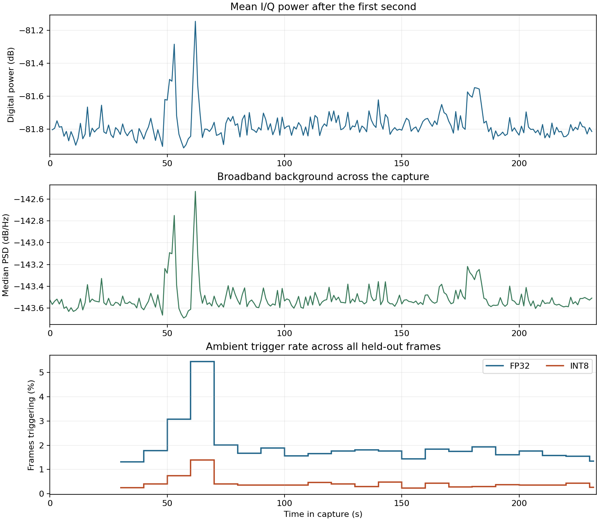

# USRP ambient baseline and within-session threshold replay

The full generator-off antenna recording supports a comparison of background stability and detector decisions during one session at the reported 10 dB gain. The measured broadband floor varied by 1.16 dB across the retained one-second summaries. FP32 triggered on 1.95% of held-out frames and INT8 triggered on 0.43%. The recording has no verified signal labels.

## Capture and signal checks

The [source recording](https://drive.google.com/file/d/1_pmfCVqJa41YR3L2EwPTCnhy2a_BL8Po/view) contains 1,855,763,448 bytes, or 231,970,431 little-endian complex float32 samples. At the reported 1 MS/s this corresponds to 231.970431 seconds. The reported receiver settings were 915 MHz, RX2 and 10 dB gain, with the generator RF output disabled. These settings come from the lab discussion. The raw format contains no timestamps, gain readbacks or overflow log. Acquisition continuity and RF power in dBm remain unverified.

The SHA-256 of the assembled file is `9f637ae161606ecd6f17284902597867ebef877f48fae5a8172e70449fc34be1`. Its second at 60 s matches the entire separately supplied 8 MB excerpt byte for byte (SHA-256 `87bd7eee2721b6f4ebe2299f4f6542f041644ad3832c2a79c023876b5244f106`). Transfer ranges were checked against their requested offsets and source length.

- Across 232 successive time windows, including the final partial second, 0 samples had a nonfinite component and 0 had a component at or above 0.99 in absolute value. The longest run of paired I/Q zeros was 8 samples.
- The opening 100 microseconds averaged -30.82 dB in digital power. The next two 100-microsecond bins measured -80.37 and -79.69 dB. Within the opening 10 ms the magnitude exceeded 0.001 at sample indices [0, 1, 2, 3, 4, 5, 6, 7]. This describes the high-amplitude portion at the file boundary. Its physical onset and origin are unknown. The analysis reserved the entire first second for startup.
- From 1 s onward, mean power per window ranged from -81.91 to -81.15 dB. Median spectral density across frequency bins ranged from -143.69 to -142.53 digital dB/Hz. The power share within ±200 Hz of the earlier −26.7334 kHz tone reached at most 0.088%. The earlier tone-dominated capture had about 99.99% in that band.
- The median share within ±1 kHz of the tuned center was 15.03%. A center-frequency feature and frequency-dependent noise are present. Across complete 1 ms windows after the first second, 0 exceeded the engineering baseline mean power by 6 dB. The strongest averaged -78.14 dB at 178.402 s. These are descriptive digital-power measures.

The middle 90% of the retained window-level spectral floors lay between -143.61 and -143.29 digital dB/Hz. The highest floor occurred at 62 s. Among frames starting in that second, FP32 triggered 187/977 times and INT8 triggered 51/977 times. The full floor excursion at fixed gain is comparable in magnitude to the planned 1 dB gain adjustment. This motivates repeat measurements at the reference gain.

## Model setup and time split

Both models use the project's matching GAP seed 19031 native Keras checkpoint and INT8 TFLite export. Multiply all raw I/Q values by one fixed factor of **12278.65135** before inference. This maps average complex power during 1–5 s to one. Those four seconds were used only to choose the scale. The setup preserves later changes in amplitude. The scaled dense test clipped 2,344 of 403,939,328 scalar values during INT8 input conversion. Without scaling, all scalar values in the systematically sampled calibration/evaluation frames mapped to code [-7.0]. This experimental scale was established on this capture.

From 5–30 s, select eight evenly spaced, disjoint 1,024-sample frames per second. Use the same 200 frames to fit each model's own cutoff. Apply the project's nominal 5% / 95% order-statistic rule, selecting rank 196 of 200 and triggering strictly above that score. From 30 s to the end, run every complete contiguous frame with those thresholds frozen. Discard the final 767 samples, fewer than one frame. Time separation prevents shared samples, though consecutive frames can still be dependent.

| Model | Strict cutoff | Calibration triggers | Held-out ambient triggers | Distinct held-out scores | Range across full 10 s test windows |
|---|---:|---:|---:|---:|---:|
| FP32 | 0.527542651 | 4/200 | 3,854/197,236 (1.95%) | 88,805 | 1.32–5.46% |
| INT8 | 0.52734375 | 0/200 | 855/197,236 (0.43%) | 7 | 0.24–1.39% |

At the INT8 boundary, 19,820 test frames had exactly the cutoff score (0.52734375). Including that single tied group would raise the ambient trigger rate to 10.48%. The most frequent INT8 score was 0.52343750, shared by 131,796 frames. Both detectors triggered on 855 of the same frames.

FP32 triggered in 202 of 202 held-out second bins and INT8 in 193. Dividing frames by their raw mean power into four equal-sized groups, from lowest to highest, the FP32 trigger percentages were 0.00%, 0.04%, 0.75%, 7.03%. INT8 gave 0.00%, 0.00%, 0.01%, 1.72%. These are associations within the capture. They do not identify a transmitter.

## What this establishes and what to measure next

This is a single-receiver, single-session ambient replay. The finite output resolution of INT8 has a measurable consequence for threshold selection on these data. A lower trigger rate alone cannot establish better sensing. An antenna can receive unknown emissions, and the capture contains no controlled signal-present intervals to measure missed detections. Neither a false-alarm guarantee nor cross-day repeatability follows from the number of adjacent frames.

On the next lab visit, repeat the generator-off receive-gain sequence **10 → 9 → 11 → 10 dB**, 11 seconds each at the same tuning and sample rate. Log actual gain, port, timestamps, source state and UHD overflow messages. Compare the two 10 dB runs for drift, then replay the other gains with the scale and thresholds above held fixed. To establish false-alarm and detection performance, collect independently labeled noise-only and known signal-present intervals and evaluate on a separate day. Testing incoming broadband noise variation separately requires fixed receive gain and a controlled source.

## Reproducibility

The [signal summaries](quality_per_second.csv), [model identities and calibration thresholds](inference.json), [calibration and systematically sampled scores](scores.csv), [all held-out scores with sample offsets](all_test_scores.npz), [per-second trigger counts](all_test_per_second.csv), and [dense replay totals](all_test_summary.json) accompany this report. The Welch spectra use a 16,384-sample Hann window, 50% overlap, and no detrending. The paths below are relative to this report.

With the capture in the parent directory and the project environment active, run `ambient_quality.py`, `ambient_scores.py`, `all_frame_replay.py`, `plot_and_check.py`, and `finish_report.py` from that parent directory. The final report generation also compares the local original 60 s excerpt. The dated source recording and model hashes identify the inputs.
